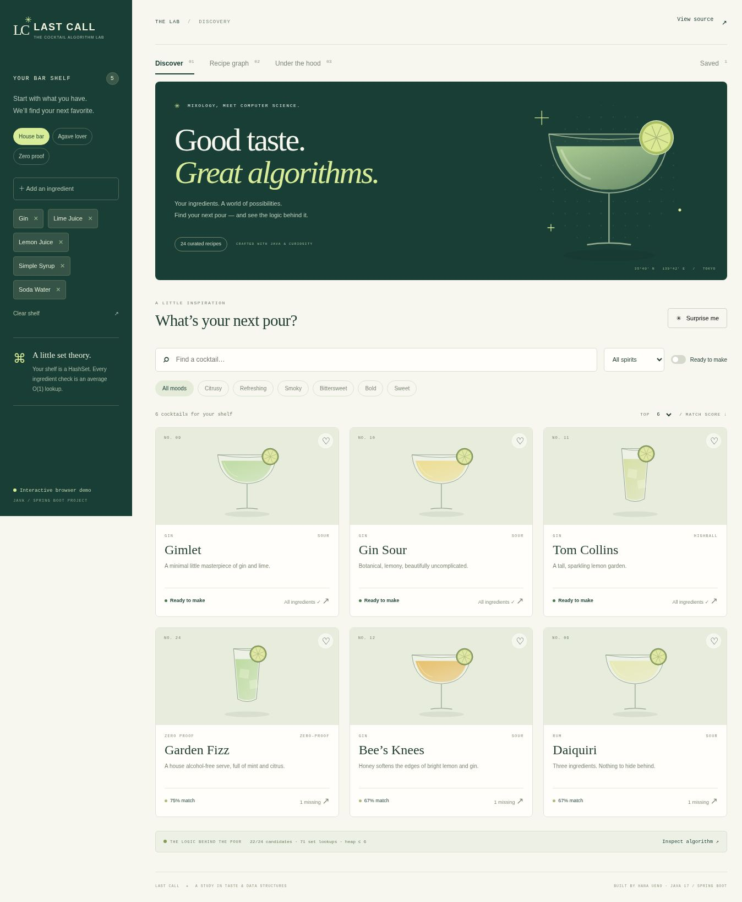

<div align="center">

# LAST CALL ✳
### Good taste. Great algorithms.

**A cocktail discovery lab that makes data structures visible.**

Java 17 · Spring Boot 3.5 · Vanilla JavaScript · JUnit 5

[Explore the interactive demo](https://last-call-algorithm-lab.livelyearth32768.chatgpt.site) · [Architecture](docs/ARCHITECTURE.md) · [日本語学習ガイド](docs/LEARNING_GUIDE.ja.md)

</div>

---

A bartender starts with a shelf of ingredients. A computer scientist sees sets, indexes, heaps, and graphs. **Last Call brings the two together**: discover what you can make, find a route between recipes, and inspect the operations behind every result.

Built for a portfolio brief combining bar work and data structures coursework. The Java backend owns the algorithms; the interface makes them inspectable. Developed with AI assistance; the learning guide provides a code-reading path and exercises for understanding and extending the implementation.



## Try it in 60 seconds

1. Open the **[public browser demo](https://last-call-algorithm-lab.livelyearth32768.chatgpt.site)**. Choose **Agave lover**; Margarita and Mezcalita are ready to make.
2. Add or remove ingredients. Toggle **Ready to make**, change the flavor filter, or choose the number of results.
3. Open **Recipe graph** and trace **Margarita → Negroni**. Inspect the shortest path, shared ingredients, and the BFS queue at every step.
4. Open **Under the hood**. Type a prefix, inspect index hits, and see how many matches the heap retained and replaced.

> **Runtime transparency:** the public demo is a static, fully interactive **JavaScript** version. It shares the catalog and matches Java’s outputs in contract tests. It does **not** call a hosted JVM. Running the Spring Boot application below serves the same interface with **all search, autocomplete, ranking, and path queries executed in Java**. The runtime badge and explanation identify the active engine. Network failures never silently switch engines.

## What it does

- **Shelf-aware discovery** — 24 house-spec cocktails, ingredient presets, ingredient autocomplete, flavor/base filters, and ready-to-make mode.
- **Explainable ranking** — ingredient coverage, exact missing ingredients in the recipe, configurable top K, and actual operation counts.
- **Recipe graph** — edges represent two or more shared core ingredients; BFS finds the fewest recipe-to-recipe hops and exposes its queue trace.
- **A little black book** — saved recipes in browser-local storage, with no account or external service.
- **Responsive interface** — keyboard-operable controls, accessible recipe dialogs, reduced-motion support, and original SVG glass illustrations.

## Where the coursework lives

| Concept | Application | Read the implementation |
|---|---|---|
| Trie / prefix tree | Cocktail and ingredient suggestions; counts prefix steps and subtree visits | [Trie.java](src/main/java/com/hana/lastcall/algorithm/Trie.java) |
| HashMap + inverted index | Ingredient → recipe IDs; union candidates before scoring | [CocktailCatalog.java](src/main/java/com/hana/lastcall/catalog/CocktailCatalog.java) |
| HashSet | Deduplicate pantry ingredients and check membership in expected O(1) | [DiscoveryService.java](src/main/java/com/hana/lastcall/service/DiscoveryService.java) |
| PriorityQueue / bounded heap | Retain only the best K matches, with the worst at the root | [DiscoveryService.java](src/main/java/com/hana/lastcall/service/DiscoveryService.java) |
| Adjacency list + queue + visited set | BFS over an undirected, unweighted recipe graph | [RecipeGraph.java](src/main/java/com/hana/lastcall/algorithm/RecipeGraph.java) |
| Independent algorithm oracles | Heap vs full sort; BFS vs Floyd–Warshall | [Tests](src/test/java/com/hana/lastcall) |

**Ranking:** coverage descending → missing count ascending → recipe name ascending. Coverage is the number of owned core ingredients divided by the recipe’s core ingredient count. It is a matching score, not a flavor prediction. A nonempty shelf only considers recipes sharing at least one ingredient; an empty shelf browses the entire catalog with 0% coverage.

**Graph semantics:** “shortest” means fewest edges under the two-shared-ingredients rule. It does not mean fewest purchases, ingredient substitutions, or a recommendation to mix recipes together. Dry Martini is intentionally isolated under this rule.

## Run the Java application

Requires **JDK 17+** and **Maven 3.6.3+**. No database, API key, frontend build, or Node installation is needed to run the application.

```bash
git clone https://github.com/lucia8731/last-call.git
cd last-call
mvn spring-boot:run
```

Open **http://localhost:8080**. The sidebar should say **Java API connected**.

```bash
# Run unit, integration, and contract-export tests; package an executable jar.
mvn verify
java -jar target/last-call-1.0.0.jar

# Optional: validate that the public demo matches Java (Node 18+).
node scripts/check-demo.mjs
```

Or use Docker:

```bash
docker build -t last-call .
docker run --rm -p 8080:8080 last-call
```

The container builds and tests the application, then runs it as a non-root user. `PORT` configures the HTTP port (default `8080`). The Docker configuration is provided for JVM hosts; see [deployment notes](docs/DEPLOYMENT.md).

## API examples

```bash
curl 'http://localhost:8080/api/suggest?prefix=ma'

curl -X POST http://localhost:8080/api/discover \
  -H 'Content-Type: application/json' \
  -d '{"pantry":["gin","lime juice","simple syrup"],"query":"","base":"all","tag":"all","readyOnly":false,"k":6}'

curl 'http://localhost:8080/api/path?from=margarita&to=negroni'
```

| Method | Route | Purpose |
|---|---|---|
| GET | `/api/health` | Engine health |
| GET | `/api/catalog` | Catalog, ingredients, and graph edges |
| GET | `/api/cocktails/{id}` | Single recipe; 404 for missing IDs |
| GET | `/api/suggest?prefix=ma&type=cocktails` | Trie suggestions; `type=ingredients` also supported |
| POST | `/api/discover` | Filtered top-K matches and measured work |
| GET | `/api/path?from=margarita&to=negroni` | Shortest path and BFS queue trace |

Discovery accepts `k=1..24`, a pantry of up to 40 known ingredient names, and bounded query/filter fields. Pantry values are trimmed, lowercased, and deduplicated. Invalid requests return HTTP 400; validation errors use problem details.

## Verification

`mvn verify` runs the Java tests, including:

- 400 seeded pantry/ranking cases against an independent full-sort oracle across five K values.
- All **576 recipe pairs** checked against Floyd–Warshall shortest distances, plus edge validity, cycle handling, unreachable nodes, and zero-hop paths.
- Trie limits, case normalization, missing branches, duplicate insertion, and exact work counters.
- Real HTTP integration tests against a Spring Boot server on a random port: UI assets, catalog, search, autocomplete, path, validation, and missing recipes.

The Java tests also export a contract fixture. `node scripts/check-demo.mjs` compares **120 searches, all 576 paths including traces, and 14 Trie queries** with the browser engine. GitHub Actions runs both suites and uploads the application jar and demo artifacts. Browser QA covers the discovery flow, presets, recipe dialog, saved state, graph, and learning panel; details are in [verification notes](docs/VERIFICATION.md).

## Deliberate trade-offs

This is a small, read-only educational application. At 24 recipes, a straightforward scan is often simpler; the data structures are chosen to demonstrate and explain behavior, **not to claim measured speedups**. There is no authentication, database, inventory quantity tracking, or production-scale benchmark. Favorites are local to one browser. The graph is precomputed at startup; the optional queue snapshots intentionally trade memory for observability.

Recipes are curated house variations, not a claim of exact IBA specifications. Core ingredients omit ice and optional garnish; sour recipes are egg-free. Colors and tags are illustrative. No external cocktail API or proprietary dataset is used.

See [architecture and complexity](docs/ARCHITECTURE.md), [deployment](docs/DEPLOYMENT.md), and the [Japanese learning guide](docs/LEARNING_GUIDE.ja.md).

## License

[MIT](LICENSE)
