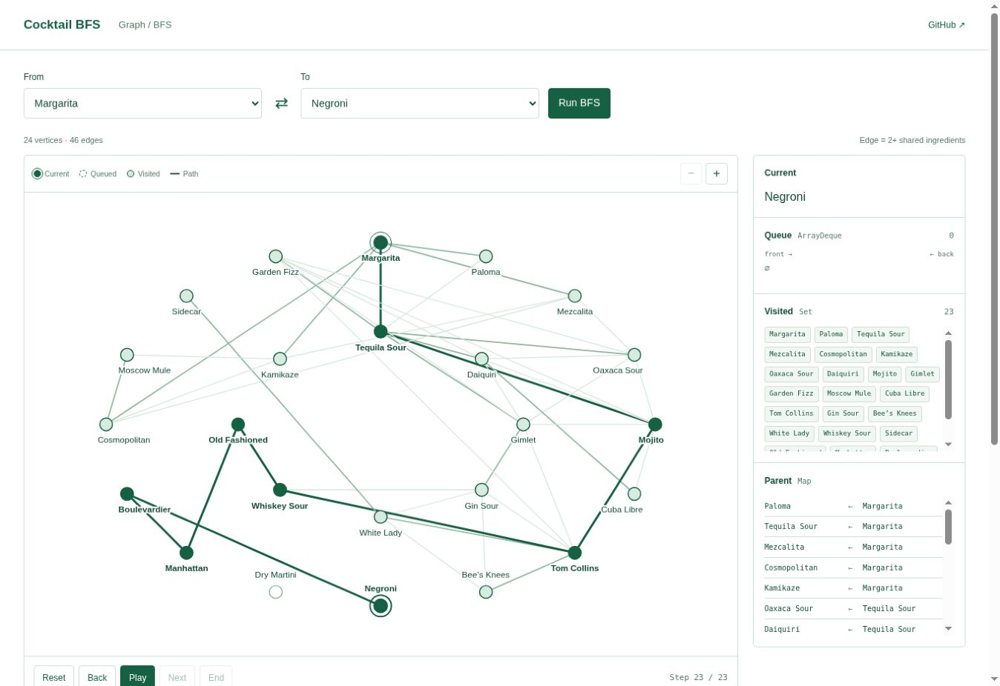

# Cocktail BFS

A student data structures experiment: step through **breadth-first search** on a graph of 24 cocktail recipes.

[Live app](https://lucia8731.github.io/cocktail-bfs/) · [Architecture](docs/ARCHITECTURE.md) · [日本語ガイド](docs/LEARNING_GUIDE.ja.md)



## Use

1. Choose **From** and **To**. An edge means two recipes share at least two core ingredients.
2. **Run BFS** plays the search. **Reset**, **Back**, **Next**, **End**, and the slider replay individual steps.
3. Inspect **Current**, **Queue**, **Visited**, and **Parent** alongside the graph. The shortest path appears when the search finishes.
4. Select a vertex to inspect its ingredients and neighbors. Expand **Adjacency list** or **Trace** for the underlying data.

The interface uses white and green, two font families, and no decorative illustrations. The graph is the application; there is no discovery or marketing page. On narrow screens the graph can be scrolled horizontally and zoomed, while the state panels stack below it.

## Data structures

| Structure | Role | Implementation |
|---|---|---|
| Adjacency list | Store each recipe’s neighbors | [RecipeGraph.java](src/main/java/com/hana/cocktailbfs/algorithm/RecipeGraph.java) |
| `ArrayDeque` | FIFO frontier for BFS | [RecipeGraph.java](src/main/java/com/hana/cocktailbfs/algorithm/RecipeGraph.java) |
| Visited set | Mark a vertex when enqueued; avoid cycles | [RecipeGraph.java](src/main/java/com/hana/cocktailbfs/algorithm/RecipeGraph.java) |
| Parent map | Reconstruct a shortest path | [RecipeGraph.java](src/main/java/com/hana/cocktailbfs/algorithm/RecipeGraph.java) |
| Playback state | Reconstruct queue/set/map at any recorded step | [graph-state.js](src/main/resources/static/graph-state.js) |


## Java / Spring Boot

Requires JDK 17+ and Maven 3.6.3+. No database, API keys, or frontend build are required.

```bash
git clone https://github.com/lucia8731/cocktail-bfs.git
cd cocktail-bfs
mvn spring-boot:run
```

Open **http://localhost:8080**. The footer shows **Java / Spring Boot**; graph queries execute in Java.

```bash
mvn verify
java -jar target/cocktail-bfs-1.0.0.jar
```

**Runtime:** GitHub Pages and the secondary [hosted demo](https://cocktail-bfs.livelyearth32768.chatgpt.site) run equivalent browser algorithms on the shared catalog. They do not call a hosted JVM. The runtime is labeled in the footer. The Spring Boot application serves the same interface with its Java REST API; failures never silently change engines.

## Tests

```bash
mvn verify
node scripts/check-demo.mjs
node scripts/check-playback.mjs
```

- 31 Java test invocations, including 400 heap/full-sort comparisons and all 576 ordered graph pairs against Floyd–Warshall.
- Browser engine parity against Java: 120 search cases, 576 BFS paths/traces, and 14 Trie queries.
- Playback checks every step of all 576 traces: queue order, visited membership, parent links, final counts, rewind, and bounds.
- HTTP integration tests exercise the real Spring Boot server, UI assets, validation, and API errors.

## API

```bash
curl 'http://localhost:8080/api/catalog'
curl 'http://localhost:8080/api/path?from=margarita&to=negroni'
```

The backend also retains the earlier Trie autocomplete, ingredient index, and bounded top-K search exercises through `/api/suggest` and `/api/discover`. They have no page in this graph-focused interface. [Architecture](docs/ARCHITECTURE.md) documents their contracts and trade-offs.

`Dockerfile` and `render.yaml` provide optional JVM deployment configuration. Docker execution and a hosted JVM service are not claimed. See [deployment notes](docs/DEPLOYMENT.md).

Recipes are small house variations; ice and optional garnish are omitted from edge matching. This is an educational project developed with AI assistance, not a production inventory or recommendation system.
