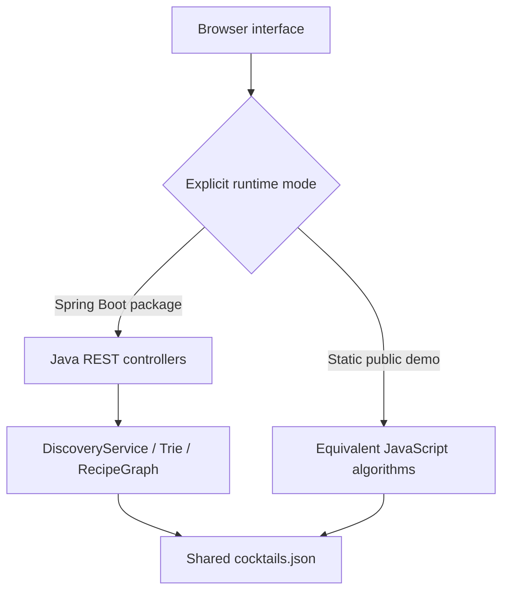

# Architecture & algorithm notes

## Two runtimes, one interface

The Java application serves static frontend assets and JSON endpoints from the same origin. `runtime-config.js` selects `api` in the application jar. The demo exporter explicitly changes it to `demo`; it never switches mode because a fetch failed. No CORS configuration or external service is needed.

The JSON catalog is the source of truth. Spring loads it once, validates unique IDs and ingredient/measure alignment, and builds its indexes. Catalog entries use immutable Java records and defensive list copies. Indexes are constructed before Spring publishes the component; requests use request-local heaps, queues, and visited sets. The graph topology and trie are not mutated by endpoints.

## Search pipeline

1. Normalize and deduplicate the pantry into a `HashSet<String>`.
2. Traverse pantry ingredients in sorted order, unioning posting lists from the ingredient → recipe-ID index into a `LinkedHashSet`. Deterministic iteration also makes counters comparable across runtimes.
3. Filter candidates by recipe name, base, and flavor tag.
4. Partition each recipe’s ingredients into `matched` and `missing` using hash membership checks.
5. Calculate coverage and offer eligible matches to a bounded `PriorityQueue`.
6. Sort only the retained K matches for display.

### Why reverse the comparator?

`BEST_FIRST` sorts by coverage descending, then missing count ascending, then name. Java’s priority queue exposes its least element. Reversing this comparator places the **worst retained result at the root**. When a better result arrives, remove the root and insert the newcomer. At no point does the queue hold more than K entries.

Heap `offers` counts eligible candidates considered (including rejected ones); `evictions` counts replacements of a retained result; `maxHeapSize` is the actual peak retained size. The score is coverage, not semantic similarity or predicted enjoyment. Query matching is a case-insensitive substring filter; autocomplete independently uses prefix matching.

### Cost model

Let N be catalog size, M unique ingredients, P pantry size, R the sum of posting-list lengths read, C unique candidate recipes, I maximum ingredients per recipe, K the requested result cap, Q query length, L maximum recipe-name length, and Σ the character alphabet.

| Operation | Time | Extra space / retained data |
|---|---|---|
| Normalize/deduplicate pantry | Expected O(P), excluding input character costs | O(P) |
| Union candidate IDs | O(P log P + P log M + R) | O(C) |
| Filter, score, bounded ranking | O(C × (I + L × Q) + C log K + K log K), expected hash lookups | O(K × I) retained matches, plus O(C) candidate IDs |
| Trie suggestions | O(prefix length × log Σ + S), S matching-subtree nodes actually visited | O(output size + recursion depth) |
| Build recipe graph once | Expected O(N² × I) | O(V + E × I) adjacency and shared-ingredient metadata |
| Core BFS query | O(V + E) | O(V) |
| BFS with optional educational snapshots | O(V² + E) worst case | O(V²) trace, in addition to graph storage |

The ingredient index is a `TreeMap` for stable alphabetical catalog output, while recipe ID lookup uses `LinkedHashMap`. Trie child links use `TreeMap<Character, Node>` to emit lexicographic suggestions without scanning unrelated recipes. Hash-based bounds assume expected constant-time membership; string hashing/comparison costs and response serialization add work. The compact UI formula focuses on scoring/ranking after retrieval; it is not a complete end-to-end benchmark.

The API deliberately bounds the dataset (24 nodes) and K (1–24). The full trace is practical here. A production-sized graph should disable snapshots, stream trace events, or impose a trace budget.

## Graph model and BFS

- One vertex per recipe.
- An undirected edge exists iff two recipes share **at least two exact core ingredient names**.
- No self-loops or ingredient substitutions.
- Every edge has equal weight, so BFS gives a shortest path in hop count.
- Mark vertices visited **when enqueuing**, not when dequeuing; otherwise cycles can enqueue duplicates.
- Store the predecessor once, then walk backward from the destination to reconstruct the path.
- A recipe may be unreachable. `Dry Martini → Negroni` returns an empty path. `Dry Martini → Dry Martini` returns the single start node and zero edges examined.

Trace rows contain the node just dequeued, the queue after processing it, and the newly discovered nodes. `visited` counts discovered/enqueued nodes; it can be larger than processed rows if the target is reached with items still in the queue. `edgesExamined` counts adjacency entries inspected, so an undirected edge can be examined in both directions.

## Boundaries

Controllers validate request sizes, known filter values, and K. The service rejects ingredients outside the catalog. The application is read-only and contains no accounts, credentials, database, or external API calls. Favorites stay in localStorage. The browser escapes catalog/error strings before HTML insertion, debounces searches, and ignores obsolete search/path responses.

## Suggested extension

A "what should I buy next?" feature could count how many new recipes each missing ingredient unlocks, using the existing inverted index. For weighted recipe transitions, define the cost precisely and replace BFS with Dijkstra’s algorithm. Neither feature is implemented; the current graph should not be presented as solving a weighted shopping problem.
